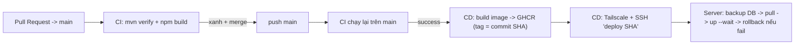

# CI/CD – DanaSea

## Luồng tổng quát



| File | Vai trò |
|---|---|
| `.github/workflows/ci.yml` | Kiểm tra backend (`mvn verify`) + frontend (`npm ci`, lint, build) |
| `.github/workflows/cd.yml` | Chỉ chạy khi CI trên `main` thành công. Build & push image lên GHCR, rồi deploy |
| `scripts/deploy.sh` | Script deploy trên server: backup DB, pull image, healthcheck, rollback |
| `docker-compose.prod.yml` | Compose production, dùng image `ghcr.io/capkimkhanh2k5/danasea-*:<sha>` |

## Cấu hình một lần (ngoài code)

### 1. GitHub Secrets (Settings → Secrets and variables → Actions)

| Secret | Giá trị |
|---|---|
| `TAILSCALE_AUTHKEY` | Auth key Reusable + Ephemeral (nên gắn tag `tag:ci`) |
| `SERVER_TAILSCALE_IP` | Kết quả `tailscale ip -4` trên server |
| `SERVER_USER` | `capkimkhanh` |
| `SSH_PRIVATE_KEY` | Private key dành riêng cho CI |
| `SSH_KNOWN_HOSTS` | Kết quả `ssh-keyscan -t ed25519 <SERVER_TAILSCALE_IP>` (chạy từ máy Mac khi đã bật Tailscale) |

### 2. GitHub Environment + Branch Protection

- Settings → Environments → tạo `production` (tuỳ chọn: bật *Required reviewers* để duyệt tay trước khi deploy).
- Settings → Branches → rule cho `main`:
  - Require a pull request before merging
  - Require status checks: `Backend (Java 21)`, `Frontend (Node 22)`

### 3. Server: cài script deploy và khoá key CI

```bash
cd ~/danasea && git fetch origin && git checkout --detach origin/main
sudo install -m 755 scripts/deploy.sh /usr/local/bin/danasea-deploy
```

Sửa dòng key CI trong `~/.ssh/authorized_keys` (thêm tiền tố):

```text
command="/usr/local/bin/danasea-deploy",restrict ssh-ed25519 AAAA... github-actions-deploy
```

> Script nằm ở `/usr/local/bin` thuộc quyền root, nên CI không sửa được. Khi `scripts/deploy.sh` thay đổi, chạy lại lệnh `sudo install` ở trên.

### 4. Server: đăng nhập GHCR (image mặc định là private)

Tạo GitHub PAT (classic) chỉ có scope `read:packages`, rồi chạy:

```bash
echo <PAT> | docker login ghcr.io -u capkimkhanh2k5 --password-stdin
```

### 5. Tailscale ACL (Admin console → Access controls)

Chỉ cho runner CI vào cổng 22 của server:

```json
{
  "tagOwners": { "tag:ci": ["autogroup:admin"], "tag:server": ["autogroup:admin"] },
  "acls": [
    { "action": "accept", "src": ["autogroup:member"], "dst": ["*:*"] },
    { "action": "accept", "src": ["tag:ci"], "dst": ["tag:server:22"] }
  ]
}
```

Trên server: `sudo tailscale up --advertise-tags=tag:server`. Tạo lại auth key có tag `tag:ci`.

## Vận hành

- Deploy thủ công: Actions → CD → *Run workflow*.
- Rollback thủ công về một commit cũ (chạy trên server): `danasea-deploy deploy <sha>`.
- Backup DB trước mỗi lần deploy: `~/backups/danasea/` (giữ 7 bản gần nhất).
